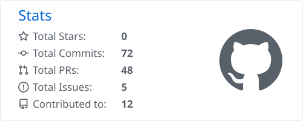

<h3>Production agents for regulated Financial Services Provable, governed, and still running after go-live.</h3>

 

---

## 🧭 About me

I design and ship AI agents on Copilot Studio, Microsoft Foundry and Power Platform for regulated, high-scale environments, mostly Financial Services.

- 🏗️ **Build.** Agents that take real business actions: approval chains rebuilt as Copilot Studio agents with human checkpoints, classic topic-tree bots re-platformed onto generative orchestration, canvas apps re-platformed as Power Apps code apps, legacy estates rebuilt on Dataverse
- 🧠 **Scale.** When Copilot Studio is not enough, I move to Microsoft Foundry: Agent Service, Foundry Models and Tools, grounded on Dataverse and SharePoint, with line-of-business systems exposed as governed tools through MCP servers and connectors
- 🛡️ **Prove.** Every agent runs under its own Entra Agent ID. Evaluations run in the release pipeline, next to the ALM, CI/CD and DLP controls a regulated business needs before go-live
- 🎖️ **Frontier.** I hold Microsoft's Frontier Transformation Engineer credential, the partner badge for people who actually ship AI, not just pilot it. Earning it meant passing the GitHub Copilot, Azure AI and agent builder exams and then the Frontier and Hyper-Velocity Engineering assessment. That is where my HVE Core work started
- 🧰 **Code.** Hands-on C#/.NET, TypeScript, APIs and Azure keep the architecture honest about what can actually be built
- ✍️ **Write.** Grounded: AI & Architecture, a newsletter on enterprise AI delivery: the trade-offs, the failure modes, and what survives contact with production
- 🤝 **Connect.** Based in the USA, with Capgemini. Moving agents from pilot to production in a regulated environment, or stuck on why yours stalled? Glad to compare notes

---

## 🛠️ Tech stack

**Top skills**

 

**Platforms**

**Agent tooling**

**Engineering**

---

## 🎯 Core strengths

| | Area | In practice |
|:-:|:--|:--|
| 🤖 | **Agentic AI architecture** | Intent-to-action design · multi-agent orchestration · tool and MCP integration · human-in-the-loop controls · guardrails · evaluation · production observability |
| 🧠 | **Microsoft Foundry & generative AI** | Agent Service · Foundry Models and Tools · Azure OpenAI · grounding on Dataverse and SharePoint · tool design · evaluations and tracing · safety controls |
| ⚡ | **Copilot Studio & Power Platform** | Generative orchestration · connected agents · agent skills · Dataverse · Power Apps and code apps · Power Automate · Power Pages · MCP- and API-centric integration across Azure PaaS, line-of-business apps and Microsoft 365 |
| 🛡️ | **AI governance, identity, security & ALM** | Responsible AI · Entra Agent ID and access · Purview audit and eDiscovery · DLP and data boundaries · lifecycle governance · environment strategy · CI/CD · monitoring · operational resilience |
| 🗂️ | **Legacy modernisation** | Lotus Notes to Dataverse at migration scale · topic-tree bots to generative orchestration · canvas apps to code apps · approval chains to agents |
| 🚀 | **Agentic SDLC** | Microsoft HVE Core · research, plan, implement, review loop · governed GitHub Copilot delivery · Copilot Studio agent skills |

---

## 🧰 Agents in Practice

> *Ready-to-use building blocks for your own agents.* Skills, prompts, agent instructions and Adaptive Cards for Microsoft 365 Copilot, Copilot Studio, Power Automate, Teams and GitHub Copilot. Every item cites the Microsoft Learn pages it relies on, with their dates.

<!-- AGENTS-IN-PRACTICE:START -->

| Category | Items | Latest |
|:--|:-:|:--|
| 🧩 **Skills** | 5 | [OWASP Risks to Copilot Studio Controls](https://ari20089.github.io/agents-in-practice/skills/owasp-copilot-studio/) · [Agent Identity Review Gate](https://ari20089.github.io/agents-in-practice/skills/agent-identity-review-gate/) · [Computer-Using and Autonomous Agents in Regulated FS](https://ari20089.github.io/agents-in-practice/skills/computer-use-autonomous-agents-fs/) |
| 💬 **Prompts** | 5 | [HVE Core Adoption Check](https://ari20089.github.io/agents-in-practice/prompts/hve-core-adoption-check/) · [Code App PR Description](https://ari20089.github.io/agents-in-practice/prompts/code-app-pr-description/) · [Copilot Studio Harness Chooser](https://ari20089.github.io/agents-in-practice/prompts/copilot-studio-harness-chooser/) |
| 📋 **Agent instructions** | 3 | [Dataverse Table Designer](https://ari20089.github.io/agents-in-practice/agent-instructions/dataverse-table-designer/) · [Connector Call Wrapper Generator](https://ari20089.github.io/agents-in-practice/agent-instructions/connector-call-wrapper-generator/) · [Copilot Agent Governance Reviewer](https://ari20089.github.io/agents-in-practice/agent-instructions/copilot-agent-governance-reviewer/) |
| 🃏 **Adaptive Cards** | 4 | [Plan Approval](https://ari20089.github.io/agents-in-practice/adaptive-cards/plan-approval/) · [Cited Answer](https://ari20089.github.io/agents-in-practice/adaptive-cards/cited-answer/) · [Confirm Before Acting](https://ari20089.github.io/agents-in-practice/adaptive-cards/confirm-before-acting/) |
<!-- AGENTS-IN-PRACTICE:END -->

---

## 📐 Microsoft community contributions

> Client work stays with the client. What I can publish lands in the Microsoft and PnP repos.

### Reference architectures · [microsoft/PowerPnPGuidanceHub](https://github.com/microsoft/PowerPnPGuidanceHub)

<table>
  <tr><th width="150" align="center">Status</th><th align="left">Architecture</th><th align="left"></th></tr>
  <tr><td width="150" align="center"></td><td><a href="https://github.com/microsoft/PowerPnPGuidanceHub/issues/114"><b>Agent Operations Center</b> for Copilot Studio &amp; Power Platform</a></td><td>Monitoring, recovery, retry, escalation and SLA tracking for agents that take real business actions</td></tr>
  <tr><td width="150" align="center"></td><td><a href="https://github.com/microsoft/PowerPnPGuidanceHub/issues/26"><b>Audit, eDiscovery &amp; Regulator-Ready Evidence</b>, Purview-first</a></td><td>Agent execution separated from compliance operations, audit events into Purview, eDiscovery for production</td></tr>
  <tr><td width="150" align="center"></td><td><a href="https://github.com/microsoft/PowerPnPGuidanceHub/issues/117"><b>Governed agentic ALM</b> with HVE Core &amp; Power Platform pipelines</a></td><td>AI-built code-first components, governed from how a change is produced to how it is deployed</td></tr>
</table>

### Skills, agents, samples and posts

<table width="100%">
  <tr><th align="left">Repo</th><th align="left">Contribution</th><th width="150" align="center">Status</th></tr>
  <tr><td nowrap><a href="https://github.com/microsoft/cat-agent-skills">microsoft/cat-agent-skills</a></td><td><b>Copilot Studio skill</b> · <a href="https://microsoft.github.io/cat-agent-skills/skills/agent-rai-impact-assessment/">Agent RAI impact assessment</a></td><td width="150" align="center"></td></tr>
  <tr><td nowrap><a href="https://github.com/microsoft/cat-agent-skills">microsoft/cat-agent-skills</a></td><td><b>Copilot Studio skill</b> · <a href="https://microsoft.github.io/cat-agent-skills/skills/power-platform-solution-compare/">Power Platform solution compare</a></td><td width="150" align="center"></td></tr>
  <tr><td nowrap><a href="https://github.com/microsoft/cat-agent-skills/pulls?q=author%3Aari20089+state%3Aopen">microsoft/cat-agent-skills</a></td><td><b>Copilot Studio skill</b> · Agent inventory audit</td><td width="150" align="center"></td></tr>
  <tr><td nowrap><a href="https://github.com/microsoft/copilot-studio-gallery/pull/97">microsoft/copilot-studio-gallery</a></td><td><b>Copilot Studio agent</b> · 401(k) Loan &amp; Withdrawal Assistant</td><td width="150" align="center"></td></tr>
  <tr><td nowrap><a href="https://github.com/pnp/copilot-prompts/pulls?q=author%3Aari20089+state%3Aopen">pnp/copilot-prompts</a></td><td><b>5 Copilot samples</b> <i>Skills:</i> Declarative agent manifest builder, Code Apps RPI skill <i>Agent instructions:</i> Power Platform Build Advisor, US FS Agent Scope Writer <i>Prompt:</i> Canvas → code app migration plan</td><td width="150" align="center"></td></tr>
  <tr><td nowrap><a href="https://github.com/pnp/blog">pnp/blog</a></td><td><b>Community post</b> · <a href="https://pnp.github.io/blog/post/microsoft-hve-core-governed-agentic-engineering/"><i>Who keeps the judgment when AI carries the rules? Microsoft HVE Core in practice</i></a></td><td width="150" align="center"></td></tr>
  <tr><td nowrap><a href="https://github.com/pnp/script-samples">pnp/script-samples</a></td><td><b>Script sample</b> · <a href="https://pnp.github.io/script-samples/spe-export-container-inventory-to-csv/README.html?tabs=pnpps">Export SharePoint Embedded container inventory to CSV</a></td><td width="150" align="center"></td></tr>
</table>

---

## ✍️ Grounded: AI & Architecture

> *Real delivery. Real trade-offs.* One decision from a real engagement per issue, including where I got it wrong.

<table>
  <tr><th width="170" align="center">Issue</th><th align="left">Title</th><th align="left">Takeaway</th></tr>
  <tr><td width="170" align="center"></td><td><a href="https://www.linkedin.com/pulse/15-december-unmanaged-developer-environments-get-what-choudhury-6cohe"><b>15 December: Unmanaged Developer Environments Get Suspended. What Breaks?</b></a></td><td>Inventory every unmanaged developer environment before the deadline, then convert, migrate or retire it</td></tr>
  <tr><td width="170" align="center"></td><td><a href="https://www.linkedin.com/pulse/copilot-studio-changed-still-need-foundry-arindam-choudhury-3y0je"><b>Copilot Studio Changed. Still Need Foundry?</b></a></td><td>Does the boundary hold now the GitHub Copilot harness is GA?</td></tr>
  <tr><td width="170" align="center"></td><td><a href="https://www.linkedin.com/pulse/mcp-spec-changes-28-july-arindam-choudhury-cin6e"><b>The MCP Spec Changes on 28 July</b></a></td><td>A 15-minute review before approving any MCP server</td></tr>
  <tr><td width="170" align="center"></td><td><a href="https://www.linkedin.com/pulse/day-agent-asked-wrong-question-arindam-choudhury-bn1le"><b>The Day the Agent Asked the Wrong Question</b></a></td><td>Context engineering beats better prompts</td></tr>
  <tr><td width="170" align="center"></td><td><a href="https://www.linkedin.com/pulse/human-in-the-loop-button-its-design-decision-arindam-choudhury-m7tze"><b>Human-in-the-Loop Is Not a Button</b></a></td><td>Decision boundaries per action type, not approval by default</td></tr>
  <tr><td width="170" align="center"></td><td><a href="https://www.linkedin.com/pulse/capable-design-provable-question-changed-architecture-choudhury-rfihe"><b>Capable by Design. Provable by Design.</b></a></td><td>Step-level trace, eval pipelines, per-domain risk tiers</td></tr>
  <tr><td width="170" align="center"></td><td><a href="https://www.linkedin.com/pulse/copilot-needed-orchestration-just-prompts-when-alone-choudhury-8zbye"><b>Copilot Needed Orchestration, Not Just Prompts</b></a></td><td>When prompting alone failed</td></tr>
  <tr><td width="170" align="center"></td><td><a href="https://www.linkedin.com/pulse/from-canvas-apps-code-eight-seconds-changed-my-arindam-choudhury-r6lte"><b>From Canvas Apps to Code Apps</b></a></td><td>The eight seconds that changed the architecture</td></tr>
</table>

---

## 🏅 Credentials

**18 on Microsoft Learn** · 3 Expert · 9 Associate · 1 Specialty · 2 Fundamentals · 3 further Microsoft and GitHub credentials

**Expert**

**Associate & Specialty**

**Fundamentals & foundations**

**Leadership, partner & community**

**Copilot Dev Camp badges**

---

## 📊 GitHub activity

<picture>
  <source media="(prefers-color-scheme: dark)" srcset="./profile-summary-card-output/github_dark/3-stats.svg">
  
</picture><picture>
  <source media="(prefers-color-scheme: dark)" srcset="https://streak-stats.demolab.com?user=ari20089&hide_border=true&theme=github-dark-blue">
  
</picture>

---

**Shipping an agent into a regulated business, or trying to work out why yours stalled?**

